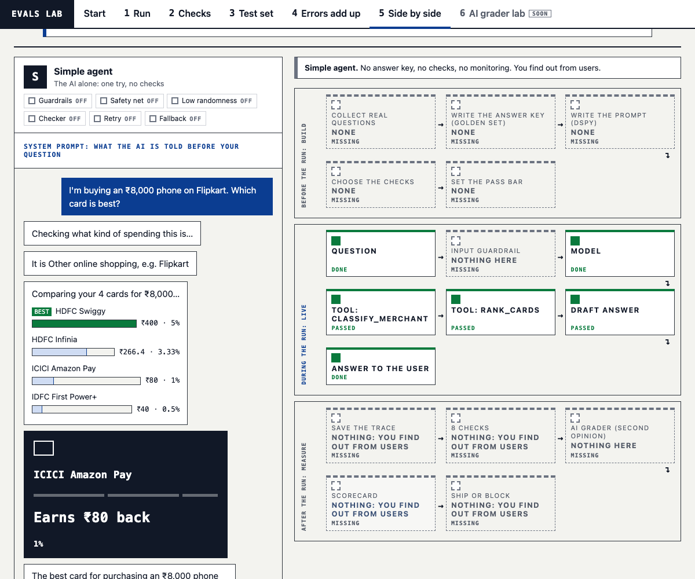
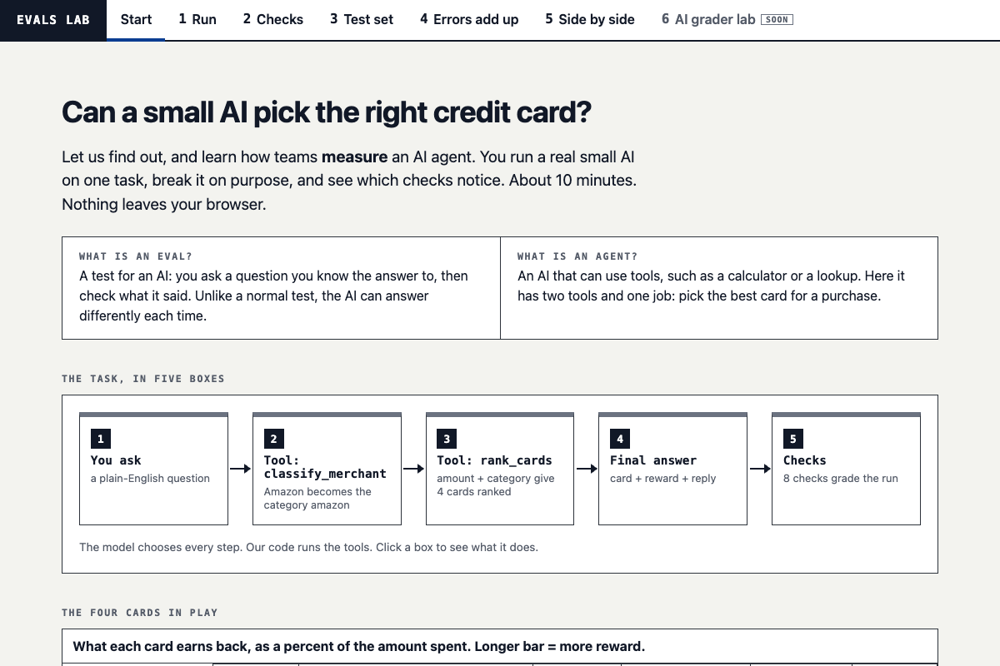
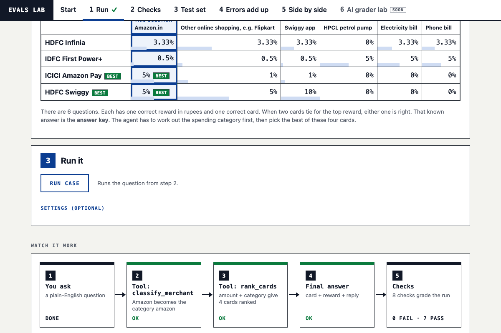
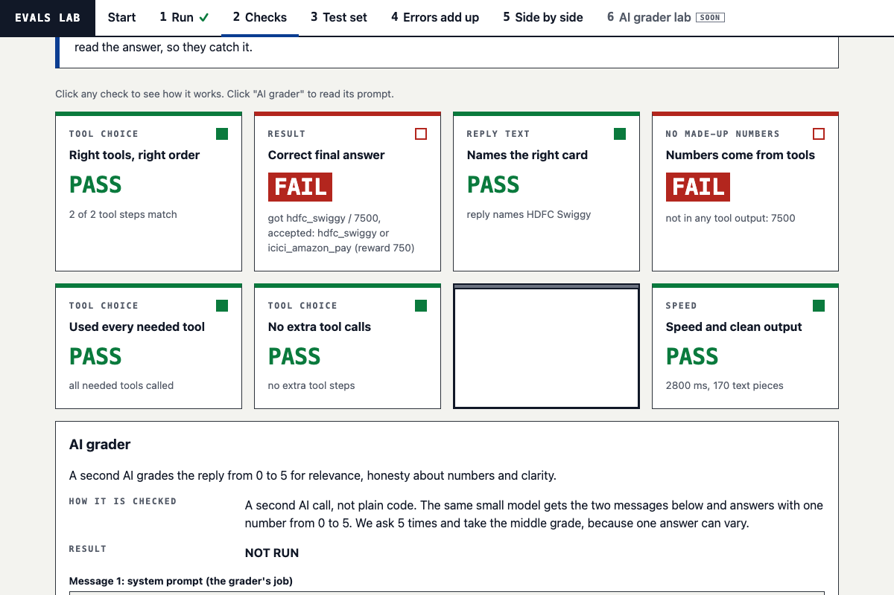
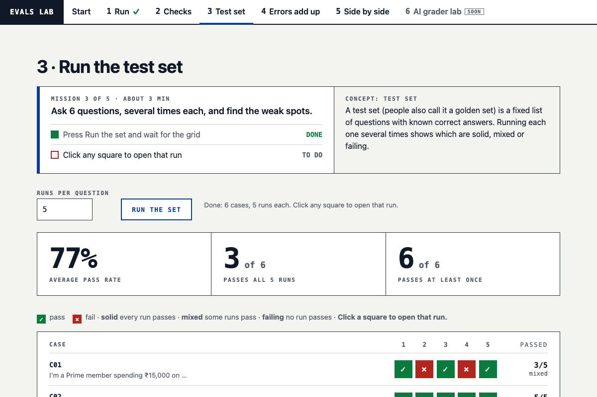
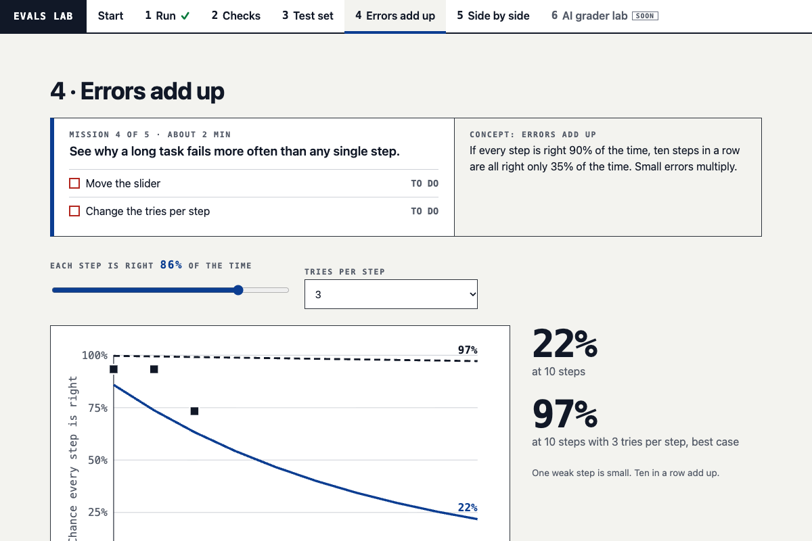
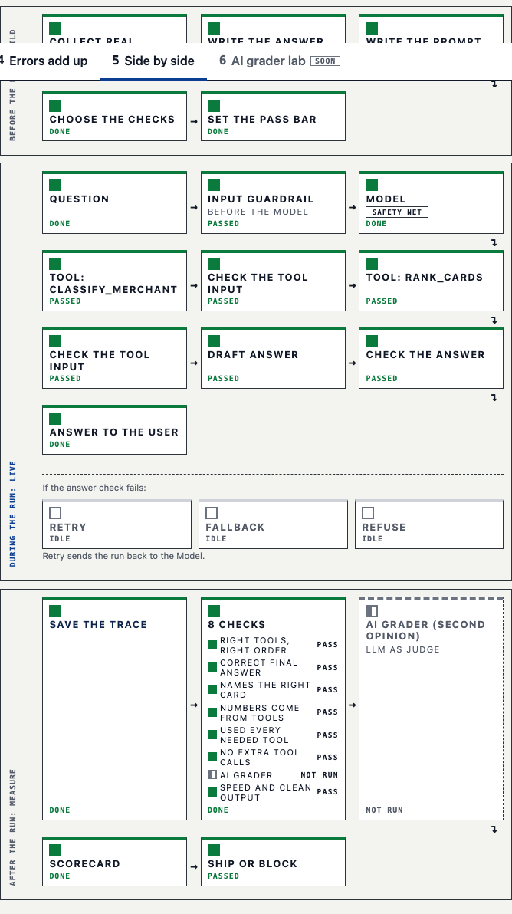
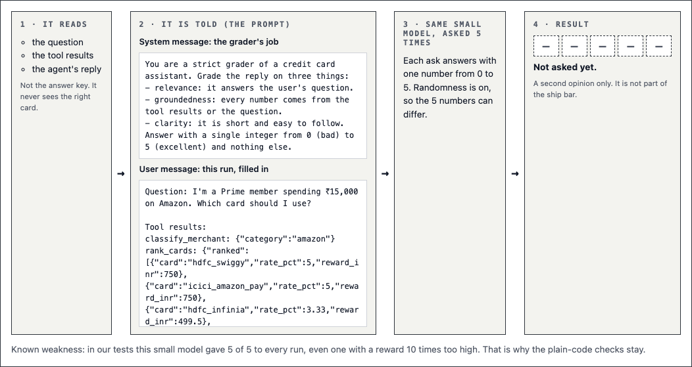
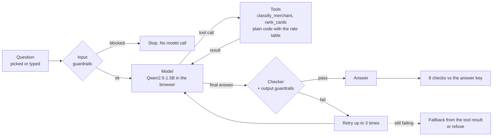

<div align="center">

# Evals Lab

**You can't improve what you can't measure.**<br>
A browser page that teaches how to evaluate an AI agent, using a small model that runs on your own computer.

[](https://github.com/itsnoobj/evals-labs/actions/workflows/pages.yml)


**[Open the live page](https://itsnoobj.github.io/evals-labs/)** · [How it works](#how-it-works) · [Run it locally](#run-it-locally) · [Repo layout](#repo-layout)



</div>

---

## What it is

Companion to the talk _"You Can't Improve What You Can't Measure"_ (AI Pune 2026, [abstract](talk/abstract.md)).

A small model (Qwen2.5-1.5B through [WebLLM](https://github.com/mlc-ai/web-llm)) picks the best credit card for a purchase. The page lets you:

- run the agent and watch every step,
- score the run with 8 checks and break it on purpose to see which checks notice,
- run a test set and see the run-to-run spread,
- see how small errors add up over many steps,
- compare a **simple agent** with a **careful agent** (guardrails, safety net, checker, retries, fallback).

No server, no API key, no build step. Everything runs in the browser. If your browser has no WebGPU, the page replays real runs recorded earlier.

## The screens

|                                                                 |                                                                                                          |
| --------------------------------------------------------------- | -------------------------------------------------------------------------------------------------------- |
| **Start.** The task as a diagram, plus one mission per screen.  |                                          |
| **1 Run.** Watch the agent call tools, step by step.            |                                              |
| **2 Checks.** 8 checks, plus a bug injector. Click any check.   |                                        |
| **3 Test set.** 6 questions × several runs = a pass-rate grid.  |                                      |
| **4 Errors add up.** Per-step accuracy compounds over steps.    |                           |
| **5 Side by side.** Same question, two agents, wiring on.       |            |
| **AI grader.** The exact prompt an LLM-as-judge is given.       |                           |

Every box in every diagram opens a panel with the real data of the run and a short list of open-source tools for that step (for example Langfuse for tracing, Promptfoo for evals).

## How it works



The model knows **no card rates**. Rates live in two plain-code tools. The model only chooses which tool to call and copies numbers from the result, so every wrong answer is a measurable agent mistake, not a trivia gap.

| Part                | Simple agent             | Careful agent                                          |
| ------------------- | ------------------------ | ------------------------------------------------------ |
| Prompt              | same system prompt       | same system prompt                                     |
| Output format       | free JSON                | schema-constrained steps (safety net)                  |
| Randomness          | default (0.7)            | low                                                    |
| Guardrails          | none                     | 4 input rules, 5 output rules                          |
| Checker             | none                     | checks every try, never reads the answer key           |
| Retry and fallback  | one try                  | up to 3 tries, then fallback from the tool result      |

### Measured with the real model

Qwen2.5-1.5B-Instruct (q4f16_1), 6 questions × 5 runs, temperature 0.7. Source: [`benchmarks/RESULTS.md`](benchmarks/RESULTS.md).

| Mode                         | Task success   |
| ---------------------------- | -------------- |
| Free JSON reply              | 23 / 30 = 76.7% |
| Constrained to a schema      | 26 / 30 = 86.7% |

The careful agent, replaying the recorded constrained runs, passed the checker 26 times on the first try and 4 times after a retry. Five runs per question is a small sample, so treat the percentages as indicative.

### The answer key

Four real Indian credit cards, six questions, every rate cell with a source URL and a confidence level (see [`docs/answer-key-audit.md`](docs/answer-key-audit.md)). Assumptions are shown on the Start screen: Prime member, first purchase of the month, direct card payment, HDFC Infinia points valued at ₹1 (its best value, 3.33%). _Educational, not financial advice. Rates change._

## Run it locally

Needs Node 22.13 or newer. The page itself has no dependencies; `npm install` only fetches the formatter and linter.

```bash
npm install
npm start        # serves evals-lab/ on http://localhost:8000/
npm test         # 14 test files with node --test
npm run verify   # lint + format check + tests (what CI runs)
```

Open <http://localhost:8000/>, press **Load model** (first load downloads about 880 MB, then it is cached) or **Use recorded runs**. WebGPU needs a recent Chrome or Edge, and the page must be served from `localhost` or `https`.

## Repo layout

```text
evals-lab/                 the deployed site (GitHub Pages publishes this folder)
├── index.html
├── data/                  recorded real-model runs, DSPy prompt (fetched by the page)
└── src/
    ├── task/              the card-picking task: cards, rates, tools, answer key, typed questions
    ├── agent/             agent loop, careful agent, guardrails, WebLLM adapter
    ├── evals/             the 8 checks, bug injector, scoring
    ├── ui/                pure functions that return HTML (chat, wiring graph, panels, lessons)
    ├── app/               one module per screen, state.js, main.js (entry point)
    └── styles/            plain CSS, square flat style
tests/                     mirrors src/: agent/, evals/, task/, ui/, scripts/
scripts/                   serve, syntax check, re-record runs, audit the answer key
benchmarks/                real-model results per model and setting, RESULTS.md
docs/                      design notes, specs, research, answer-key audit, decisions
talk/                      talk abstract
```

Design rules the code follows: pure functions return data or HTML strings and never touch the DOM, so they run in Node tests; the DOM is touched only in `src/app/`; no build step, no framework, ES modules only.

## Re-record the real runs

Needs Chrome, a GPU and `puppeteer-core` (`npm i --prefix /tmp/spike-tools puppeteer-core`). No server is needed, requests are served from disk.

```bash
node scripts/record-runs.mjs --constrain 0 --runs 5   # free JSON reply
node scripts/record-runs.mjs --constrain 1 --runs 5   # schema constrained
node scripts/make-recorded-runs.mjs                   # rebuild evals-lab/data/recorded-runs.json
node scripts/audit-key.mjs                            # print the answer-key audit as markdown
```

## Known limits

- Live model path: an earlier build ran live in Chrome on one machine (Apple M4 Max). The latest careful-agent and wiring screens were checked only with the recorded runs, because the automated headless checks cannot use WebGPU.
- A typed question has no answer key, so the checks that need a key show NOT RUN.
- The tools know 6 merchants. An unknown merchant returns a tool error, on purpose.
- Monthly caps (for example IDFC's ₹2,000 utility bucket) are assumed not to be reached.

## Docs

[`docs/README.md`](docs/README.md) lists the design notes, the specs and the research behind every rate.
